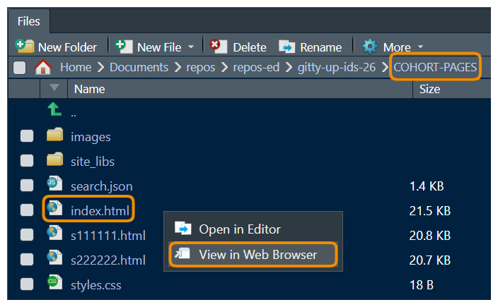
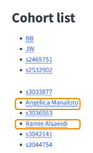

# Gitty-up

## What is this?

This is your “howdy, world” GitHub repo. You can clone this from
Rstudio:

- New project
- From “Version control”
- Paste the url `https://github.com/TeachHealthData/gitty-up-ids26.git`

## How to contribute to it

Then you can create a new qmd file - name it as your student number
(s123456.qmd). This is important - don’t add any other “useful”
information into this filename.

Then commit your file, and push to GitHub using GitHub Desktop.

## How to see other people’s contributions

Using either GitHub Desktop or the RStudio Git pane, **pull** from the
remote.

This will bring the changes to your local machine - you can do this as
often as necessary as new files are added, so you can stay up to date.

Next you can render the Quarto project.

All rendered files will be placed into the directory `COHORT-PAGES`.

Open that and then open the file `index.html` in your browser.

That should open a landing page where you can see which of your peers
has uploaded their page which will look something like this

